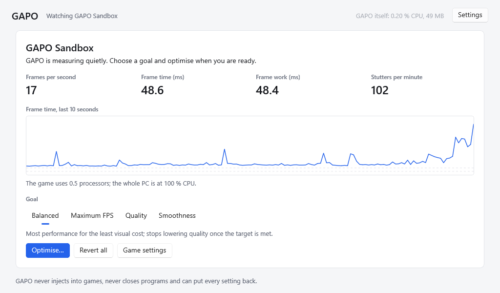
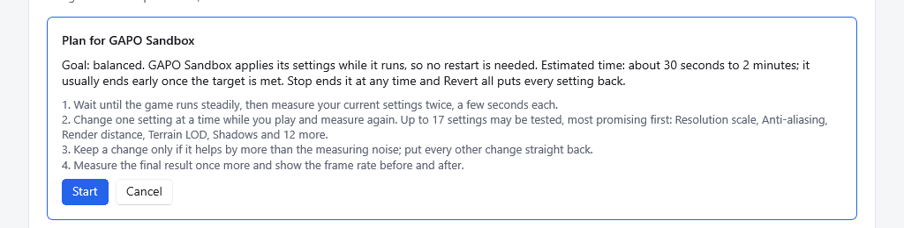
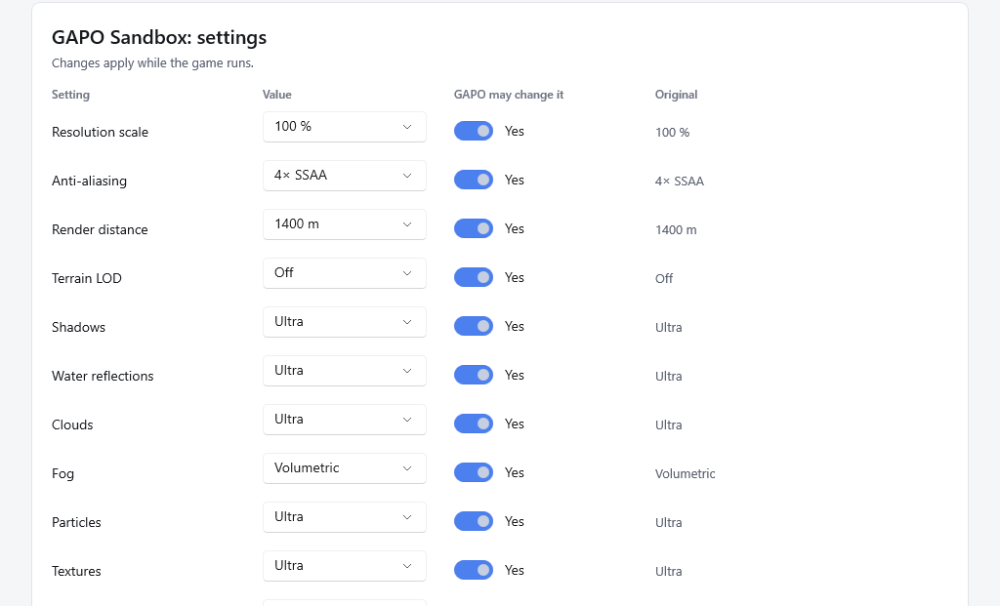
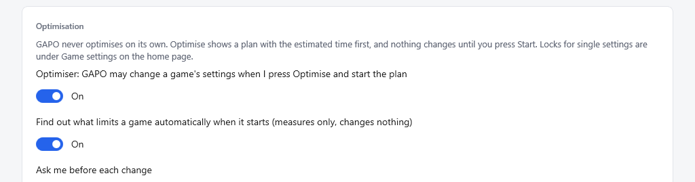

# GAPO: game performance, measured

**GAPO (Game Adaptive Performance Optimizer)** is a Windows app that watches your PC games while you play, tells you what is holding them back, and, only when you ask, tests one game setting at a time and keeps only the changes that measurably help. Everything it changes can be put back with one click.

> **Status: 0.9 beta.** This is the first release meant for real Steam games. GAPO has been tested end to end on its own test games, on a Windows 10 laptop and on Windows CI. Its first contact with real Steam games is this beta, so please report what you see.

<p align="center">
  
</p>

## What it does

- **Measures any running Steam game.** You see frames per second, frame time, stutters per minute, a 10-second frame-time chart, and how much processor the game uses. GAPO finds the game by itself through your Steam library and the list of running programs.
- **Says what limits the game.** After about 20 seconds of play it tells you whether the graphics card, one processor thread, the whole processor or something else is the limit. It reports this from measurements, without changing anything.
- **Optimises when you ask.** Press **Optimise…** and GAPO first shows a plan: which settings it may test, how many game restarts it needs and an estimated time. Nothing changes until you press **Start**. A progress bar then shows the time left.
- **Proves every change.** GAPO changes one setting, measures the same kind of play again, and keeps the change only if it beats the measuring noise. Otherwise it puts the setting straight back. The result screen shows the frame rate before and after and the reason for every decision.
- **Shows an FPS overlay.** A small box over the game shows live FPS and, after an optimisation, before and after. It is a separate GAPO window on top of the game, never injected into it.
- **Leaves you in control.**
  - Lock settings GAPO must never touch.
  - Set a value yourself, or put back a single setting.
  - Have GAPO ask before each change.
  - Forbid frame-rate caps or choose a frame-rate target.
  - Limit the number of restarts.
  - Switch the optimiser off entirely.

<p align="center">
  
</p>

## Which games

| Game | What GAPO does |
|---|---|
| Any Steam game | Measures it live and says what limits it |
| Unreal Engine games without anti-cheat | Also optimises: lowers one graphics setting per game restart in the game's `GameUserSettings.ini` and keeps it only if each frame takes measurably less work |
| Games with Easy Anti-Cheat or BattlEye | Measured only; their files are never touched |
| Other engines (Unity, Source, custom) | Measured only in 0.9 |

## Install

1. Download `GAPO-0.9.0-win-x64.zip` from the [0.9.0-beta release](https://github.com/mathforreallife/adaptive-performance/releases/tag/v0.9.0-beta) and unzip it.
2. Double-click **Install.cmd**. GAPO is installed for your account only: no administrator rights are needed to install. It goes to the Start menu and the desktop, and appears under **Settings → Apps** for uninstalling.
3. When the installer offers to add your account to **Performance Log Users**, say **Y**, then sign out of Windows and back in once. Windows allows reading frame times to that group, so GAPO can then run without administrator rights.

Windows 10 or 11 (64-bit) is required. Nothing else needs installing; .NET and the Windows App SDK are bundled. GAPO is not code-signed yet, so SmartScreen may warn you: choose **More info → Run anyway**.

The full user guide is in [`docs/USER-GUIDE.md`](docs/USER-GUIDE.md); the release zip includes it as `READ-ME-FIRST.md`.

## What GAPO promises

- It **never** injects into games, reads game memory, installs drivers, changes BIOS settings or closes programs.
- It changes a game only the way a player would, by editing the game's own settings file. It records the original first, so **Revert all** restores it byte for byte. A copy of the original file is also kept next to it as `*.gapo-original`.
- It reports only what it measured. Every number on the result screen comes from frames it timed on your PC.
- It stays light. GAPO shows its own CPU and memory use at all times, and every build is gated on an overhead test. The background agent used about 0.15–0.3 % CPU on the test machines, and the window about 0.2–0.4 %.

<p align="center">
  
</p>
<p align="center">
  
</p>

## Results so far

Measured by the automated test rig on GAPO's own test games, not on commercial games:

| Test | Result |
|---|---|
| Live optimisation of a deliberately wasteful test game | about +140 to +155 % average FPS on the laptop (25 → 60 FPS, capped to the display); +22 % on a faster CI machine that was already close to its 64 Hz target, with frame work halved |
| Restart-based optimisation of an Unreal-style test game | between +37 % and +300 % average FPS over up to 6 restarts, varying from run to run with measurement noise; Revert all restored the file byte for byte every time |
| Live FPS of a game GAPO knows nothing about | within about 4 % of the game's own counter |
| Plan estimate vs reality | live: estimate 28–105 s, took 65 s; restarts: estimate 160–815 s, took 202 s |

Real games will gain less. A real game's defaults are not deliberately wasteful, and many already run at the frame-rate target. In that case GAPO says so and changes nothing.

## How it works

```text
 GAPO window (WinUI 3)                       GAPO agent (background, low priority)
┌───────────────────────────────┐  named   ┌─────────────────────────────────────────────┐
│ live numbers, chart, overlay  │◀─ pipe ─▶│ finds Steam games (library + process list)  │
│ plan card, progress, results  │          │ frame times: Windows event tracing (DXGI)   │
│ settings, locks, preferences  │          │ GPU busy time: DxgKrnl events               │
└───────────────────────────────┘          │ diagnosis: what limits the frame            │
                                           │ optimiser: change one → measure → keep/undo │
                                           │ crash-safe change journal → Revert all      │
                                           └─────────────────────────────────────────────┘
```

Frame timing uses the same Windows event tracing that PresentMon uses. A cross-check against PresentMon 2.6 agreed within 0.1 % on frame time and about 3 % on GPU busy time. Decisions follow the measurement noise: GAPO measures your current settings twice, and a change has to beat the difference between those two runs.

## Build from source

You need Windows 10/11 x64 and the .NET SDK 10.0.404 or later (see [`global.json`](global.json)).

```powershell
dotnet build Gapo.slnx -c Release
dotnet test --solution Gapo.slnx -c Release
.\tools\package-release.ps1          # writes artifacts\release\GAPO-<version>-win-x64.zip
```

| Path | What |
|---|---|
| `src/Gapo.Core` | Measurement, statistics, diagnosis, optimisation engine, estimates, protocol |
| `src/Gapo.Windows` | Event tracing, hardware inventory, Steam library, change journals |
| `src/Gapo.Agent` | Background agent: game detection, live data, optimisers |
| `src/Gapo.App` | WinUI 3 window, overlay, settings |
| `src/Gapo.Adapters.Sandbox` | Knowledge for the test game |
| `fixture/` | The test game used by the end-to-end rig |
| `tests/Gapo.EndToEnd` | End-to-end rig: real game, agent and window on Windows, with overhead gates |
| `tools/Gapo.SourceRules` | CI check that product source has no code comments |
| `docs/` | User guide, architecture decisions (`adr/`), handover notes |
| `Adaptive-Performance-FINAL.md` | Product specification, with lessons learned marked 🧪 / ✏️ / ➕ |

Every push runs [`.github/workflows/windows.yml`](.github/workflows/windows.yml): build, unit tests, the no-comments check and the full end-to-end rig.

## Roadmap

- **Real-game testing** of the Unreal adapter on PCs with Steam (the most important next step).
- More engines: Unity games, plus games that keep settings in JSON or XML files.
- More launchers: Epic Games, GOG.
- A shared knowledge base, so GAPO knows which settings matter for each game before it tests.
- GPU busy time on PCs with hardware-accelerated GPU scheduling.
- Code signing and an MSIX package.

The original proof-of-concept demo (WinForms, .NET Framework) is kept in [`demo/`](demo/) for reference.
